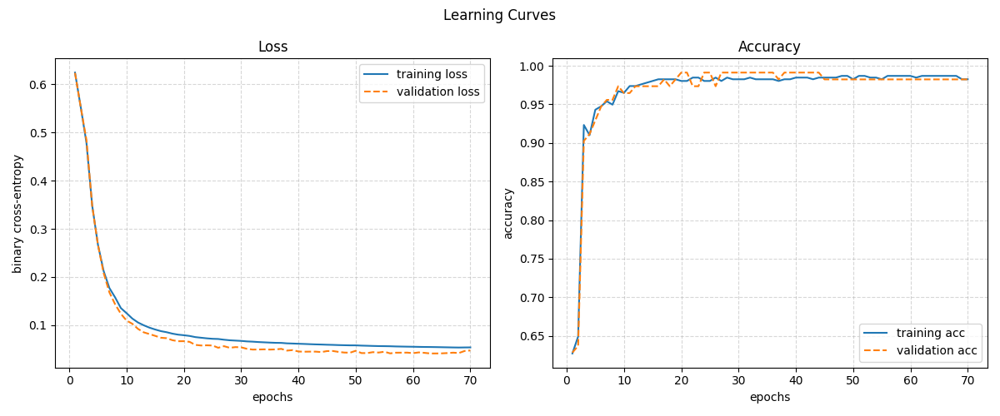

# multilayer-perceptron

A neural network built **from scratch in Python with NumPy** (no ML framework)
to classify breast cancer tumors as malignant or benign, using the Wisconsin
Diagnostic Breast Cancer (WDBC) dataset. 42 Paris project, see `en.subject.pdf`
for the full subject.

## Results

With the default settings (2 hidden layers of 24 neurons, sigmoid, 70 epochs,
mini-batches of 8, learning rate 0.05, seed 42), on the validation set
(113 patients):

| metric | value |
|---|---|
| accuracy | 98.2 % |
| recall (malignant) | 100 % (no malignant tumor missed) |
| precision (malignant) | 95.5 % |
| binary cross-entropy | 0.048 |



## How it works

- **Network** (`src/core/network.py`): fully connected layers, sigmoid or ReLU
  hidden activations, softmax output, weights initialized with a scaled normal
  distribution.
- **Training**: feedforward, backpropagation written by hand with the chain
  rule (softmax + cross-entropy simplified to `probs - y`), mini-batch gradient
  descent with reshuffling at every epoch.
- **Data**: cleaning and sanity checks, stratified train/valid split,
  normalization fitted on the training set only and saved with the model so
  predictions use exactly the same scaling.
- **Evaluation**: accuracy, precision, recall, F1 and confusion matrix at every
  epoch, history saved as JSON to compare several trainings on the same graph.

## Setup

```sh
python3 -m venv .venv
source .venv/bin/activate
pip install -r requirements.txt
```

## Quick start (Makefile)

The Makefile only chains the commands detailed in [Usage](#usage), with
their arguments (nothing is compiled). Missing files are generated
automatically: `make predict` on a fresh clone installs the venv, cleans the
dataset, splits it and trains a model first.

```sh
make                # list the targets and the variables
make install        # venv + dependencies
make explore        # summary stats + graphs of the dataset
make split          # train/valid split (SEED=42, RATIO=0.8)
make train          # train with the default settings
make train ACTIVATION=relu LAYERS="64 32 16" LR=0.01 NAME=relu_deep
make predict        # predict data/data_valid.csv (DATASET=... for another file)
make compare        # compare every history/*.json on the same graphs
make all            # split + train + predict
make clean          # remove the generated files
make fclean         # clean + remove data_clean.csv and the venv
```

## Project structure

```
src/
  split_data.py        # 1. mandatory: splits data_clean.csv into train/valid
  train.py              # 2. mandatory: trains the MLP on the split dataset
  predict.py            # 3. mandatory: loads a trained model and predicts
  compare_models.py     # bonus: curves of several trainings on the same graph
  core/
    network.py          # layers, activations, feedforward, backprop, loss, save/load
    metrics.py          # accuracy, precision, recall, f1, confusion matrix
    history.py          # metrics history per epoch, saved as JSON
    plots.py            # learning curves
    preprocessing.py    # csv loading, one-hot encoding, normalization
  tools/
    clean_data.py       # raw data.csv -> headers + sanity checks -> data_clean.csv
    explore_data.py     # EDA: summary stats + graphs, before training anything
clean_generated.sh      # removes every generated file (splits, model, history/, outputs/)
```

`split_data.py`, `train.py` and `predict.py` are the 3 mandatory programs
required by the subject. `core/` holds the code they share (network, data
prep) and is not meant to be run directly. `tools/` holds the exploratory
scripts used before/around training, not part of the mandatory pipeline.

## Usage

Clean the raw dataset (adds headers, sanity-checks values, writes
`data/data_clean.csv`):

```sh
python src/tools/clean_data.py data/data.csv data/data_clean.csv
```

Explore the cleaned dataset (prints a summary, saves graphs to `outputs/`):

```sh
python src/tools/explore_data.py data/data_clean.csv --outdir outputs/
```

Split the cleaned dataset into a training set and a validation set
(stratified by diagnosis, `--seed` for a repeatable split):

```sh
python src/split_data.py data/data_clean.csv --ratio 0.8 --seed 42
```

Train the network on the split dataset. Prints the loss/accuracy at each
epoch, saves the model (topology, weights and normalization stats) to
`saved_model.npz`, saves the metrics history (loss, accuracy, precision,
recall, f1 per epoch, train and valid, plus the hyperparameters) to
`history/<name>.json`, prints the final metrics and the confusion matrix,
then displays the learning curves (also saved to
`outputs/learning_curves.png`):

```sh
python src/train.py --train data/data_train.csv --valid data/data_valid.csv \
    --hidden-layers 24 24 --activation sigmoid --epochs 70 \
    --batch-size 8 --learning-rate 0.05 --seed 42 \
    --model-out saved_model.npz --plot-out outputs/learning_curves.png \
    --history-dir history --name my_run
```

Without `--name`, the history file is named after the hyperparameters
(e.g. `history/sigmoid_24-24_lr0.05_bs8_e70.json`).

Predict a labeled dataset with a trained model. The data is normalized with
the mean/std saved in the model, then the predictions are evaluated with the
binary cross-entropy (plus accuracy, precision, recall, f1 and the confusion
matrix). The prediction of each patient is saved to `outputs/predictions.csv`:

```sh
python src/predict.py data/data_valid.csv --model saved_model.npz \
    --out outputs/predictions.csv
```

Compare several trainings (bonus): draws the curves of their histories on
the same graphs, one graph per metric (default: `val_loss` and
`val_accuracy`), saved to `outputs/comparison.png`:

```sh
python src/train.py --activation sigmoid --seed 42
python src/train.py --activation relu --seed 42
python src/compare_models.py history/*.json --metrics val_loss val_accuracy
```

Remove everything generated by `split_data.py`/`train.py`/`explore_data.py`
(`data/data_train.csv`, `data/data_valid.csv`, `saved_model.npz`, and the
`history/` and `outputs/` directories with their content):

```sh
./clean_generated.sh
```
